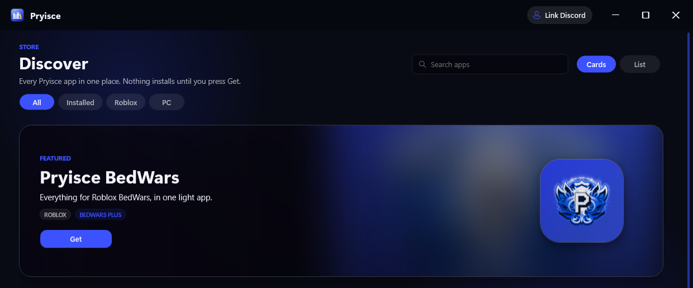
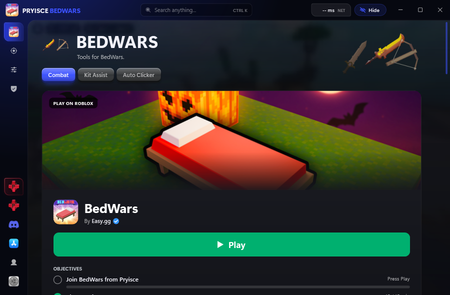

# Pryisce

One app for every Pryisce app. 
Get Pryisce BedWars, Pryisce PC Utility and every app that comes after them, update them with one press, and open them from one place. 
**One file:** download `Pryisce.exe` and run it. Nothing to unzip, nothing to install.

**[Download](https://github.com/pryisce/pryisce-downloads/releases/latest/download/Pryisce.exe)** &nbsp;·&nbsp; **[Patch notes](https://github.com/pryisce/pryisce-downloads/releases)** &nbsp;·&nbsp; **[Install](#install)** &nbsp;·&nbsp; **[Is it safe?](#is-it-safe)**

## The apps

| App | What it is for | Get it |
|---|---|---|
| **Pryisce** | The store. Gets, updates and opens every app below | [`Pryisce.exe`](https://github.com/pryisce/pryisce-downloads/releases/latest/download/Pryisce.exe) |
| **Pryisce BedWars** | Everything for Roblox BedWars, in one small panel | From inside Pryisce |
| **Pryisce PC Utility** | Tune Windows for games, and the tools to keep it that way | From inside Pryisce |

More apps are added to the store as they are made. They show up in Pryisce by themselves; there is nothing new to download.

## How it works

- **Get:** pick an app in the store and press **Get**. Nothing is downloaded until you press it.
- **Update:** when a new version is out, the app's button turns into **Update**. Pryisce never downloads or updates anything by itself; you decide when.
- **Open:** every app you have is one press away in Pryisce, in the Start menu and on your desktop if you want a shortcut.
- **Remove:** uninstall any app from Pryisce or from Windows Settings, like any other program.
- **One account:** link Discord once. Your coins and PP count while any Pryisce app is open, and never twice when several are open.
- **Plus:** each app has its own Plus, like BedWars Plus, for the extras of that app.

## Pryisce BedWars

- Auto clicker with an automatic tuner
- Smart AutoKey and Auto Kit
- Hit Fix, the crosshair and the win tracker
- Roblox mods, picture quality and the Fast Flag Lab
- Skies and shaders (BedWars Plus)
- The window and taskbar icon is the BedWars game icon, and it changes when the game's icon changes

## Pryisce PC Utility

- Windows tweaks for games, each one explained and each one can be undone
- Cleanup, large files, startup apps and background apps
- Network tools, sensors and frame time
- Benchmark, snapshots and the Advisor

## Install

1. Download [`Pryisce.exe`](https://github.com/pryisce/pryisce-downloads/releases/latest/download/Pryisce.exe).
2. Run it, link Discord if you want coins and PP, and press **Get** on the apps you want.

Needs Windows 10 or 11 (64-bit). Nothing else to install; the runtime is packed inside each file.

Apps are installed for your Windows account only, so no administrator prompt is needed to install them.

## Is it safe?

- `catalog.json` in this repository is the list of apps Pryisce reads. It is signed, and Pryisce checks the signature before it uses anything in it.
- Every download is checked against the SHA-256 listed in the signed catalog before it is installed. A file that does not match is thrown away.
- Apps are only downloaded from the addresses in the signed catalog, which are this repository's releases.
- No telemetry. Linking Discord is optional.
- Nothing is injected into a game and no game memory is read.

To check your own download, search its SHA-256 on [virustotal.com](https://www.virustotal.com/gui/home/search) or upload the file there. The SHA-256 of every app is in the release it came from.

> [!WARNING]
> Changed game files can be against a game's rules. Using Roblox mods online is at your own risk.

## Pryisce Engine

Pryisce Engine, the first Pryisce app, is now the PC and Roblox tweaks part only. It stays on its own page: [pryisce/pryisce-engine](https://github.com/pryisce/pryisce-engine). Everything for BedWars moved to Pryisce BedWars.

---

Pryisce is not affiliated with Roblox Corporation or any game publisher.

